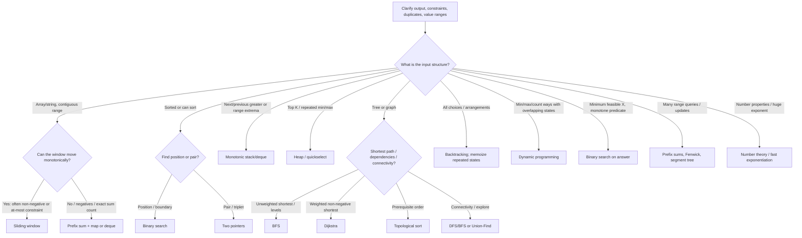

# DSA Interview Preparation Handbook (Java 17)

> **Goal:** recognize the structure behind unfamiliar problems, justify the algorithm, implement it safely, and explain trade-offs. This is a practical handbook, not a claim that keywords uniquely determine a pattern.

## How to use this handbook
1. Read the decision tree and complexity guide.
2. Learn the core invariant for a pattern before memorizing code.
3. Solve one easy, two medium, then one disguised variation.
4. Re-solve missed problems after 1, 3, 7, and 14 days.
5. In interviews: clarify constraints → state brute force → identify bottleneck → propose invariant → prove correctness → analyze complexity → test edge cases.

## 1. Complexity and constraints

| n / constraint | Often feasible (rough guide) | Cautions |
|---|---|---|
| n ≤ 10 | O(n!), O(2^n), O(n^2) | Search trees may still explode; prune |
| n ≤ 20 | O(2^n), O(n·2^n) | Bitmask DP is common; check memory |
| n ≤ 100 | O(n^3) may fit | Constant factors and multiple test cases matter |
| n ≤ 10^3 | O(n^2) often fits | 10^6 operations is not the whole story |
| n ≤ 10^5 | O(n log n), O(n) preferred | O(n^2) usually too slow |
| n ≤ 10^6 | O(n) or O(n log n) with care | memory, allocation, parsing |
| n much larger / streaming | O(log n), O(1) update, amortized methods | exploit sortedness, structure, or approximation |

These are heuristics, not guarantees. Check time limits, number of test cases, value ranges, memory, and whether the algorithm has expensive constants. Java object-heavy structures can consume much more memory than primitive arrays.

### Complexity mathematics
- Nested loops over independent n-sized ranges usually imply O(n²); halving/doubling loops imply O(log n).
- A loop that halves `x` each time runs about `floor(log2(x)) + 1` iterations.
- `1 + 2 + ... + n = n(n+1)/2 = Θ(n²)`.
- Geometric sum `1 + r + ... + r^k = (r^(k+1)-1)/(r-1)` for `r ≠ 1`.
- Amortized O(1) means an occasional expensive operation is spread across many cheap operations (e.g. dynamic-array append).
- Recurrence examples: merge sort `T(n)=2T(n/2)+Θ(n)=Θ(n log n)`; binary search `T(n)=T(n/2)+Θ(1)=Θ(log n)`.

## 2. Pattern selection decision tree



### A repeatable reasoning checklist
- **Output:** one answer, count, existence, all answers, optimum, or online updates?
- **Shape:** contiguous subarray, subsequence, subset, path, tree, interval, or graph?
- **Constraints:** does brute force fit? Is exponential search possible at n ≤ 20?
- **Values:** negative numbers? duplicates? sorted? bounded integer domain?
- **Queries:** one query or many? static data or frequent updates?
- **Monotonicity:** does feasibility remain true after increasing/decreasing a candidate?
- **State:** can a small summary represent the past? Is there an invariant?
- **Proof:** why can discarded candidates never become optimal?

## 3. Core pattern guide

### Arrays, hashing, prefix sums, difference arrays
**Recognize:** repeated membership/frequency checks; range sums; count subarrays with a target; multiple range updates.  
**Invariant:** a hash map stores the information needed from prior elements; prefix sum `P[i]` summarizes everything before/through i. A subarray sum is `P[r] - P[l-1]`. For counting sum `k`, before adding current prefix `s`, add `freq[s-k]` to the answer, then increment `freq[s]`. Seed `freq[0]=1`.  
**Difference array:** for inclusive update `[l,r] += x`, do `diff[l]+=x`, `diff[r+1]-=x`, then prefix-sum once.  
**Pitfalls:** negative values invalidate the usual sum-based sliding window; use `long` for prefix sums and counts when bounds require it; be precise about inclusive/exclusive indexing.  
**Complexity:** usually O(n) time and O(n) extra space.  
**Problems:** [Two Sum](https://leetcode.com/problems/two-sum/), [Subarray Sum Equals K](https://leetcode.com/problems/subarray-sum-equals-k/), [Corporate Flight Bookings](https://leetcode.com/problems/corporate-flight-bookings/).

### Two pointers and sliding windows
**Recognize:** sorted pair/triplet search; in-place partitioning; longest/shortest contiguous segment; fixed-size window.  
**Two pointers:** sorting often makes a monotone decision possible. If sum is too small, advance left; too large, decrement right.  
**Sliding window:** maintain state for `[left,right]`; add the new right item, shrink left while invalid, then update the answer. Works when validity changes monotonically as the window expands/shrinks. Classic sum windows usually need non-negative values.  
**Exactly K distinct:** `exactly(K) = atMost(K) - atMost(K-1)` when the counted property supports this decomposition.  
**Pitfalls:** negative numbers, off-by-one window size, duplicate handling after sorting, and confusing subsequence with contiguous subarray.  
**Complexity:** O(n) for a monotone scan; sorting adds O(n log n).  
**Problems:** [3Sum](https://leetcode.com/problems/3sum/), [Longest Substring Without Repeating Characters](https://leetcode.com/problems/longest-substring-without-repeating-characters/), [Minimum Window Substring](https://leetcode.com/problems/minimum-window-substring/).

### Binary search and binary search on the answer
**Recognize:** sorted search space, first/last boundary, rotated sorted data, or a monotone feasibility predicate such as “can we finish within D days at capacity C?”  
**Template principle:** maintain a search interval whose answer is not excluded. For lower bound, find first index with `a[i] >= target`. For answer search, define `feasible(x)` and prove it is monotone before binary searching.  
**Pitfalls:** overflow in midpoint (`lo + (hi-lo)/2`), infinite loops, duplicate boundaries, and searching a non-monotone predicate.  
**Complexity:** O(log n) checks for direct search; O(log range × feasibility cost) for answer search.  
**Problems:** [Search Insert Position](https://leetcode.com/problems/search-insert-position/), [Koko Eating Bananas](https://leetcode.com/problems/koko-eating-bananas/).

### Stacks, monotonic stacks, queues and deques
**Recognize:** nested syntax, undo/reverse order, next greater/smaller element, or a moving-window max/min.  
**Monotonic stack:** store indices and keep values increasing or decreasing. When a new value violates the order, pop and resolve those indices. Each index is pushed and popped at most once → O(n).  
**Deque:** maintain candidate indices in monotonic order; evict expired indices from the front.  
**Pitfalls:** decide strictly `>` vs `>=` based on duplicate semantics; store indices when distance/bounds matter.  
**Problems:** [Daily Temperatures](https://leetcode.com/problems/daily-temperatures/), [Largest Rectangle in Histogram](https://leetcode.com/problems/largest-rectangle-in-histogram/), [Sliding Window Maximum](https://leetcode.com/problems/sliding-window-maximum/).

### Linked lists
**Recognize:** pointer rewiring, cycle, middle, nth from end, merge, or O(1) recency operations.  
**Tools:** dummy head simplifies edge cases; fast/slow pointers find middle/cycle; a fixed gap finds nth from end; LRU combines a HashMap and doubly linked list.  
**Pitfalls:** save `next` before rewiring; test empty list, one node, head/tail removal, and cycles.  
**Problems:** [Reverse Linked List](https://leetcode.com/problems/reverse-linked-list/), [Linked List Cycle II](https://leetcode.com/problems/linked-list-cycle-ii/), [LRU Cache](https://leetcode.com/problems/lru-cache/).

### Trees and BSTs
**Recognize:** hierarchy, path, subtree, ancestor, ordering, or level-by-level traversal.  
**DFS:** recursion returns a summary from children. **BFS:** queue processes levels. **BST:** inorder traversal is sorted; range bounds validate global ordering.  
**Pitfalls:** local parent-child checks do not validate a whole BST; path sum questions often distinguish a path that may start/end anywhere from a root-to-leaf path; recursion depth can overflow on a degenerate tree.  
**Problems:** [Binary Tree Level Order Traversal](https://leetcode.com/problems/binary-tree-level-order-traversal/), [Validate Binary Search Tree](https://leetcode.com/problems/validate-binary-search-tree/), [Binary Tree Maximum Path Sum](https://leetcode.com/problems/binary-tree-maximum-path-sum/).

### Heaps and priority queues
**Recognize:** top K, continuously changing minimum/maximum, merge k sorted streams, or scheduling by priority.  
**Choose:** heap for online repeated extraction, quickselect for one kth element on average O(n), sorting when all elements are needed. Java `PriorityQueue` is a min-heap by default; use a comparator, not subtraction, for ordering.  
**Pitfalls:** stale heap entries, comparator overflow, tie-breaking, and accidentally keeping k largest in a min-heap of the wrong size.  
**Problems:** [Top K Frequent Elements](https://leetcode.com/problems/top-k-frequent-elements/), [Find Median from Data Stream](https://leetcode.com/problems/find-median-from-data-stream/).

### Graphs
**Recognize:** relationships, dependencies, transformations, grid connectivity, or routes. Model implicit relationships as edges.  
- BFS: shortest path in an unweighted graph; multi-source BFS starts all sources together.
- DFS: components, reachability, cycle detection, backtracking.
- Dijkstra: shortest paths with non-negative weights.
- Bellman–Ford: handles negative edges and detects reachable negative cycles.
- Topological sort: directed acyclic dependency order.
- Union-Find: dynamic connectivity in an undirected setting; near-constant amortized operations with path compression + union by size/rank.
**Pitfalls:** visited timing, directed vs undirected cycles, disconnected components, negative weights, and recursion depth.  
**Problems:** [Number of Islands](https://leetcode.com/problems/number-of-islands/), [Course Schedule](https://leetcode.com/problems/course-schedule/), [Network Delay Time](https://leetcode.com/problems/network-delay-time/).

### Recursion and backtracking
**Recognize:** enumerate all valid combinations, permutations, partitions, paths, or assignments.  
**Recipe:** define state → choose → recurse → undo. Prune when partial state cannot lead to a valid solution. For subsets, each item has include/exclude decisions; for permutations, track used choices.  
**Complexity:** output-sensitive; subsets O(n·2^n) including copies, permutations O(n·n!).  
**Pitfalls:** missing undo, duplicate outputs, mutable result reuse, and pruning without a proof.  
**Problems:** [Subsets](https://leetcode.com/problems/subsets/), [Combination Sum](https://leetcode.com/problems/combination-sum/), [N-Queens](https://leetcode.com/problems/n-queens/).

### Dynamic programming
**Recognize:** choices lead to overlapping subproblems; each state can be computed from smaller states.  
**Method:** define state in words, write recurrence, set base cases, choose evaluation order, then prove each transition. Memoization is top-down; tabulation is bottom-up.  
**Families:** 1D take/skip, grid DP, knapsack, subsequence DP, string edit DP, interval DP, tree DP, state-machine DP, bitmask DP.  
**Greedy vs DP:** greedy needs an exchange/stays-ahead proof; DP keeps alternatives when local choice may block a better future.  
**Pitfalls:** state omits relevant history, wrong iteration direction for 0/1 vs unbounded knapsack, and sentinel/overflow errors.  
**Problems:** [House Robber](https://leetcode.com/problems/house-robber/), [Coin Change](https://leetcode.com/problems/coin-change/), [Longest Increasing Subsequence](https://leetcode.com/problems/longest-increasing-subsequence/).

### Greedy, intervals and sweep line
**Recognize:** intervals, scheduling, local choices, or maximum overlap. Sort by start/end/event time and maintain a compact active state.  
**Proof tools:** exchange argument, stays-ahead argument, cut property, or invariant. A plausible greedy rule is not enough—prove it.  
**Pitfalls:** event tie ordering, inclusive endpoints, and choosing earliest start instead of earliest finish without justification.  
**Problems:** [Merge Intervals](https://leetcode.com/problems/merge-intervals/), [Non-overlapping Intervals](https://leetcode.com/problems/non-overlapping-intervals/), [Jump Game](https://leetcode.com/problems/jump-game/).

### Tries and string algorithms
- **Trie:** many prefix queries or dictionary words sharing prefixes.
- **KMP:** prefix-function/LPS array avoids rechecking matched characters; O(n+m).
- **Z algorithm:** `z[i]` is the longest prefix match starting at i; useful for pattern matching and prefix/suffix structure.
- **Rabin–Karp:** rolling hash screens substring matches; collisions require verification or robust double hashing.
**Pitfalls:** Unicode vs ASCII assumptions, empty pattern, indexing LPS, and hash collisions.  
**Problems:** [Implement Trie](https://leetcode.com/problems/implement-trie-prefix-tree/), [Find the Index of the First Occurrence in a String](https://leetcode.com/problems/find-the-index-of-the-first-occurrence-in-a-string/), [Longest Happy Prefix](https://leetcode.com/problems/longest-happy-prefix/).

### Bit manipulation and bitmasking
- `x & 1`: lowest bit; `x & (x - 1)` clears the lowest set bit.
- `1 << b`: bit mask for bit b (beware Java's shift-distance masking and signed 32-bit `int`; use `1L << b` for long masks).
- XOR: `x ^ x = 0`, `x ^ 0 = x`; order-independent pair cancellation.
- Bitmask DP: encode a subset of up to ~20 items in an integer mask, then transition between masks.
**Pitfalls:** Java signed shifts (`>>` vs `>>>`), shift overflow, and negative values.  
**Problems:** [Single Number](https://leetcode.com/problems/single-number/), [Counting Bits](https://leetcode.com/problems/counting-bits/), [Maximum XOR of Two Numbers in an Array](https://leetcode.com/problems/maximum-xor-of-two-numbers-in-an-array/).

### Fenwick trees, segment trees and range queries
- Prefix sums are ideal for static range sums.
- Fenwick tree supports point updates and prefix sums in O(log n), compact and simpler for additive operations.
- Segment tree supports O(log n) range queries/updates for richer associative operations; lazy propagation handles range updates.
- Coordinate compression maps large ordered values to dense indices.
**Pitfalls:** 0-based vs 1-based Fenwick indexing, update loops that fail to advance, and lazy propagation invariants.  
**Problems:** [Range Sum Query - Mutable](https://leetcode.com/problems/range-sum-query-mutable/), [Count of Smaller Numbers After Self](https://leetcode.com/problems/count-of-smaller-numbers-after-self/), [Reverse Pairs](https://leetcode.com/problems/reverse-pairs/).

## 4. Mathematics required for DSA

### Essential first
| Topic | Core idea / formula | Why and when | Pitfalls / practice |
|---|---|---|---|
| Number systems | positional value `Σ digitᵢ·baseⁱ` | digit parsing, bit tricks, base conversion | negative numbers and overflow; [Excel Sheet Column Number](https://leetcode.com/problems/excel-sheet-column-number/) |
| Divisibility, factors, primes | if composite n, it has a factor ≤ √n | factor checks and prime logic | loop condition `i <= n / i` avoids `i*i` overflow; [Count Primes](https://leetcode.com/problems/count-primes/) |
| Logarithms and growth | `log_b n = ln n / ln b`; powers dominate logs | binary search, loop analysis | distinguish O(log n) from O(n); |
| GCD / LCM | `gcd(a,b)=gcd(b,a mod b)`; `lcm=|a/gcd·b|` | ratios, periods, simplification | divide before multiply; handle zero and `Long.MIN_VALUE`; [Greatest Common Divisor of Strings](https://leetcode.com/problems/greatest-common-divisor-of-strings/) |
| Modular arithmetic | `(a+b)%m`, `(a·b)%m`; normalize negatives | huge counts and hashes | multiplication may overflow before `%`; use safe bounds or wider arithmetic |
| Fast exponentiation | square base, halve exponent; O(log n) | powers and modular powers | negative exponent and `Long.MIN_VALUE` handling; [Pow(x, n)](https://leetcode.com/problems/powx-n/) |
| Summations | `Σi=n(n+1)/2`; geometric series | loop and recurrence analysis | cast before multiplication |
| Parity / XOR | even/odd, cancellation properties | odd counts and invariants | XOR does not solve arbitrary frequency variants; [Single Number](https://leetcode.com/problems/single-number/) |
| Combinatorics | `n!`, `C(n,k)=n!/(k!(n-k)!)` | counting arrangements/choices | factorial overflow; reduce modulo carefully |
| Recurrences | define base cases + transition | DP and divide-and-conquer | recurrence must model all cases |

### Important next
- **Sieve of Eratosthenes:** mark multiples from `p*p`; O(n log log n) time, O(n) space.
- **Modular inverse:** under prime modulus p, for `a % p != 0`, inverse is `a^(p-2) mod p` (Fermat); more generally use extended Euclid when gcd(a,m)=1.
- **Probability / expectation:** expected value is `Σ x·P(X=x)`; linearity of expectation holds even without independence. Useful in randomized algorithms and expected runtime reasoning.
- **Arithmetic/geometric progressions:** arithmetic nth term `a+(n-1)d`; geometric nth term `ar^(n-1)`. Useful in sequences and growth reasoning.
- **Geometry:** distance squared `(x1-x2)^2+(y1-y2)^2` avoids square roots for comparisons; cross product `(B-A)×(C-A)` sign gives orientation. Use `long` for coordinate products when bounds demand it.
- **Proof techniques:** induction for recursive/DP algorithms; contradiction for impossibility; pigeonhole for existence; invariants for loops; exchange arguments for greedy.
- **Matrix basics:** matrix multiplication combines row/column dot products; fast matrix exponentiation computes `A^n` in O(k³ log n) with standard multiplication for k×k matrices. Use when linear recurrences need huge n.
- **Advanced:** Catalan numbers, inclusion-exclusion, gcd/extended Euclid, Chinese remainder theorem, combinatorics modulo a prime, randomized hashing, and computational geometry are role/problem dependent.

## 5. Java 17 implementation safety

### Collections quick reference
| API | Typical use | Complexity notes |
|---|---|---|
| `HashMap<K,V>` / `HashSet<E>` | frequency, membership, index map | expected O(1); worst-case and hashing costs matter |
| `ArrayDeque<E>` | stack or queue | usually preferred over legacy `Stack`; no null elements |
| `PriorityQueue<E>` | min-heap by default | offer/poll O(log n), peek O(1) |
| `TreeMap<K,V>` / `TreeSet<E>` | ordered keys, floor/ceiling, sweep line | O(log n) operations |
| `Arrays.sort` | primitive/object arrays | primitive sort is highly optimized; object comparator must be consistent |
| `Comparator.comparingInt(...)` | safe object ordering | avoid `(a,b) -> a-b` because it can overflow |

### Safe arithmetic
```java
long sum = 0L;
for (int x : nums) sum += x;

int mid = lo + (hi - lo) / 2; // avoid (lo + hi) overflow
long product = (long) a * b;  // cast before multiplication

// Normalize a remainder to [0, mod)
long r = ((x % mod) + mod) % mod;
```
Use `long` when totals can exceed ±2,147,483,647. Java integer division truncates toward zero. `Math.abs(Integer.MIN_VALUE)` remains negative; `Math.abs(Long.MIN_VALUE)` also overflows. Do not use floating-point equality for exact integer problems.

### Reusable templates

**Frequency / prefix sum count**
```java
Map<Long, Integer> freq = new HashMap<>();
freq.put(0L, 1);
long prefix = 0, answer = 0;
for (int x : nums) {
    prefix += x;
    answer += freq.getOrDefault(prefix - target, 0);
    freq.merge(prefix, 1, Integer::sum);
}
```

**Lower bound**
```java
int lo = 0, hi = nums.length; // half-open [lo, hi)
while (lo < hi) {
    int mid = lo + (hi - lo) / 2;
    if (nums[mid] >= target) hi = mid;
    else lo = mid + 1;
}
// lo is first index with nums[index] >= target, or n
```

**BFS**
```java
Queue<Integer> q = new ArrayDeque<>();
boolean[] seen = new boolean[n];
q.offer(source);
seen[source] = true; // mark when enqueued
while (!q.isEmpty()) {
    int u = q.poll();
    for (int v : graph[u]) {
        if (!seen[v]) {
            seen[v] = true;
            q.offer(v);
        }
    }
}
```

**Backtracking**
```java
void dfs(int start, List<Integer> path, int[] a) {
    // record a copy when this state is a valid answer
    for (int i = start; i < a.length; i++) {
        if (i > start && a[i] == a[i - 1]) continue; // if sorted + unique outputs
        path.add(a[i]);
        dfs(i + 1, path, a);
        path.remove(path.size() - 1); // undo
    }
}
```

**Dijkstra (non-negative edge weights)**
```java
record State(int node, long dist) {}
PriorityQueue<State> pq =
    new PriorityQueue<>(Comparator.comparingLong(State::dist));
long[] dist = new long[n];
Arrays.fill(dist, Long.MAX_VALUE);
dist[src] = 0;
pq.offer(new State(src, 0));
while (!pq.isEmpty()) {
    State cur = pq.poll();
    if (cur.dist() != dist[cur.node()]) continue; // stale entry
    for (Edge e : graph[cur.node()]) {
        long nd = cur.dist() + e.weight();
        if (nd < dist[e.to()]) {
            dist[e.to()] = nd;
            pq.offer(new State(e.to(), nd));
        }
    }
}
```
Define an `Edge` record/class appropriate to your adjacency representation. Dijkstra is invalid with negative edge weights.

**Fenwick tree (1-indexed)**
```java
class Fenwick {
    private final long[] bit;
    Fenwick(int n) { bit = new long[n + 1]; }
    void add(int i, long delta) {
        for (; i < bit.length; i += i & -i) bit[i] += delta;
    }
    long sum(int i) {
        long s = 0;
        for (; i > 0; i -= i & -i) s += bit[i];
        return s;
    }
    long rangeSum(int l, int r) { return sum(r) - sum(l - 1); }
}
```

## 6. Common pattern confusions

| Compare | Use A when | Use B when | Important boundary |
|---|---|---|---|
| Sliding window vs prefix + map | contiguous window validity is monotone | exact target counts, negative values, non-monotone validity | negative numbers often break sum-window shrinking |
| Two pointers vs sliding window | pointers exploit sorted order / pair relation | maintain a contiguous range and state | both may be O(n), but invariants differ |
| Greedy vs DP | local choice has a correctness proof | future consequences require comparing states | intuition is not proof |
| BFS vs DFS vs Dijkstra | unweighted shortest / levels | reachability / components / exhaustive exploration | weighted non-negative edges need Dijkstra |
| Heap vs monotonic stack | globally best candidate / top K / repeated extraction | next greater/smaller and dominated candidates | stack resolves elements in order |
| Binary search vs answer search | search sorted items/boundary | search numeric answer with monotone feasibility | prove predicate monotonic |
| Backtracking vs DP | enumerate distinct solutions | repeated states can be reused | memoization may not help when outputs themselves are required |
| Fenwick vs segment tree | additive prefix/range queries, point updates | richer operations, range updates, custom merges | Fenwick is not a universal segment-tree replacement |
| Union-Find vs DFS | many incremental undirected connectivity merges | one-off traversal, paths, directed graph reasoning | DSU does not provide actual paths |
| Quickselect vs heap | one kth selection, average linear time | streaming or repeated top-K queries | quickselect worst case can be O(n²) |
| Subarray / subsequence / subset | contiguous | order preserved, gaps allowed | arbitrary selection disregards order |
| Permutations / combinations | order matters | order does not matter | avoid duplicate branches |
| GCD/LCM vs enumeration | periodicity / common divisors | tiny search space or non-number-theoretic constraints | absolute values and overflow matter |

## 7. Disguised pattern case studies

1. **Subarray Sum Equals K** sounds like a window problem. With negative values, shrinking is not monotone; prefix sum + frequency map counts earlier prefixes equal to `current-k`. Counter-variation: if all values are positive and only the shortest sum-at-least-target is needed, a sliding window is often simpler.
2. **Shortest Subarray with Sum at Least K** looks like a normal window, but negatives can make a later prefix smaller; use prefix sums + monotonic deque. If all values are positive, the ordinary window is enough.
3. **Koko Eating Bananas** sounds like rate calculation. The answer is a speed; “can finish at speed x” is monotone, so binary search the answer.
4. **Daily Temperatures** asks for future warmer days, not explicitly a stack. Maintain unresolved indices in a monotonic decreasing stack.
5. **Course Schedule** is a dependency problem. Convert prerequisites into a directed graph and detect a cycle / topologically sort.
6. **Task Scheduler** looks like simulation. Frequency bounds or a max-heap plus cooldown reasoning gives a more direct solution.
7. **Word Break** looks like string recursion. State `dp[i] = whether prefix [0,i) can be segmented`; dictionary checks transition from reachable prefixes.
8. **Subsets** can be backtracking or bitmasking. Use backtracking for natural incremental constraints; bitmask iteration is useful when n is small and subsets are states.
9. **Range Sum Query - Mutable** is not just prefix sums: updates invalidate all later prefix values. Fenwick or segment tree supports both updates and queries.
10. **Count of Smaller Numbers After Self** can be seen as rank queries. Coordinate compression + Fenwick, or merge-sort counting, exploits order rather than pairwise comparison.

## 8. Progressive roadmap (8 weeks; adjust pace)

| Week | Focus | Exit criteria |
|---|---|---|
| 1 | Complexity, math essentials, arrays, hashing, prefix sums | explain O(n), O(n log n), prefix-map invariant |
| 2 | Two pointers, sliding windows, sorting, binary search | identify negative-value traps and monotone predicates |
| 3 | Stack, monotonic stack/deque, queues, heaps, greedy, intervals | implement each template from memory |
| 4 | Linked lists, trees, BST, recursion | solve traversal and pointer problems without edge-case bugs |
| 5 | Graph BFS/DFS, topological sort, Union-Find, Dijkstra | model a story as a graph and select the correct shortest path |
| 6 | Backtracking, 1D/2D DP, knapsack, subsequences | state definition + recurrence + base cases |
| 7 | Tries, KMP/Z/hash, number theory, bitmask, Fenwick/segment tree | solve one representative advanced problem per family |
| 8 | Mixed unseen questions, timed mocks, error log | explain approach and proof in 5 minutes before coding |

### Weekly practice rhythm
- 5 days: 1 new problem + 1 re-solve per day.
- 1 day: 3-question mixed set with no topic labels.
- 1 day: review wrong answers, write down the mistaken assumption, and explain the optimal solution aloud.
- For each problem record: first clue, brute force, invariant, complexity, failed edge case, and what change would break the pattern.

## 9. Final interview checklist
- Did I clarify input bounds, duplicates, mutation, and empty cases?
- Did I explain brute force before optimizing?
- Is the pattern supported by a structural clue, not just a keyword?
- Can I state the invariant and prove why the algorithm is correct?
- Are integer ranges safe in Java?
- Did I test minimum input, all-equal, sorted/reverse-sorted, negative values, duplicates, and boundary cases?
- Did I state time and auxiliary space complexity accurately?


## 10. Practice catalog index

See `DSA_LeetCode_Practice_Catalog.md` for a pattern-organized catalog with difficulty, primary pattern, identification clue, priority, and direct links. See the cheat sheet for quick revision and the workbook for shuffled recognition drills.
